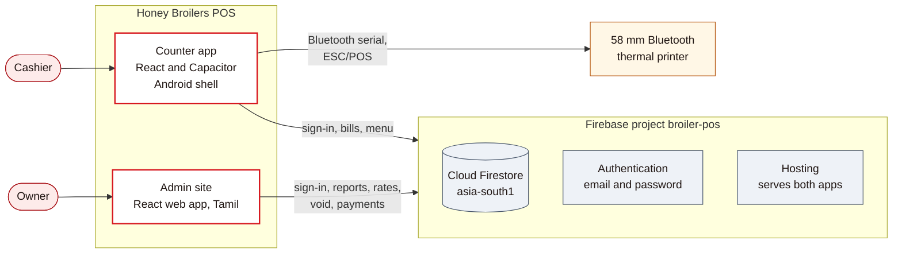
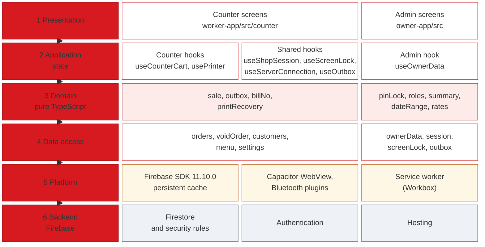
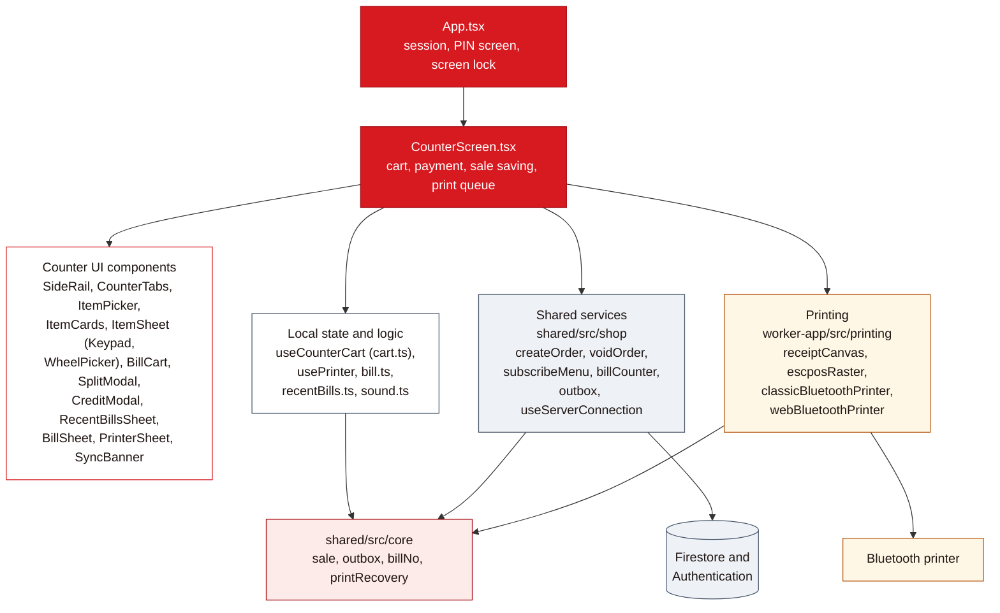
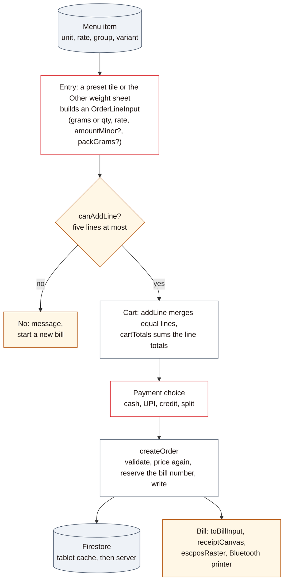
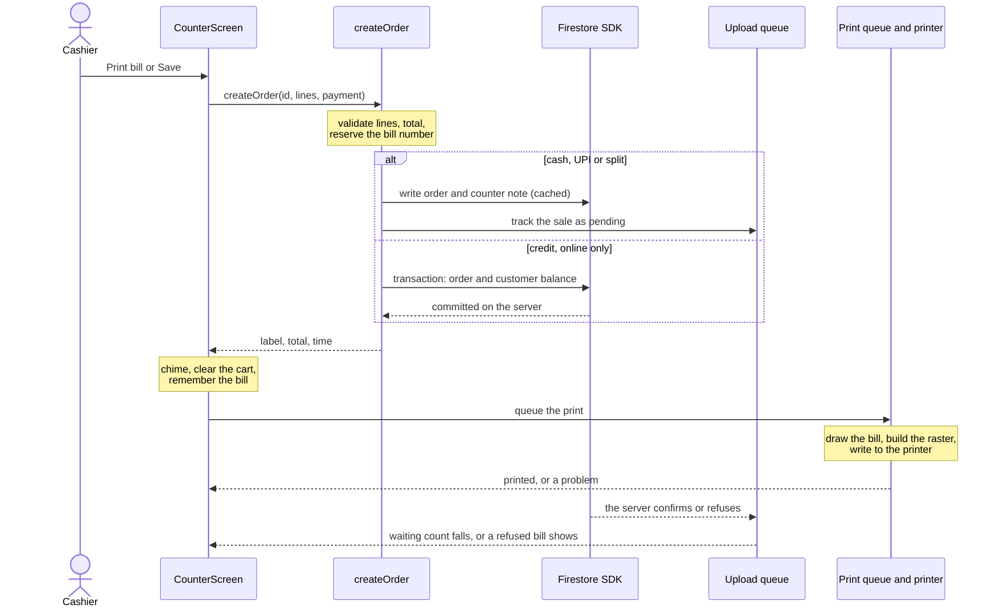
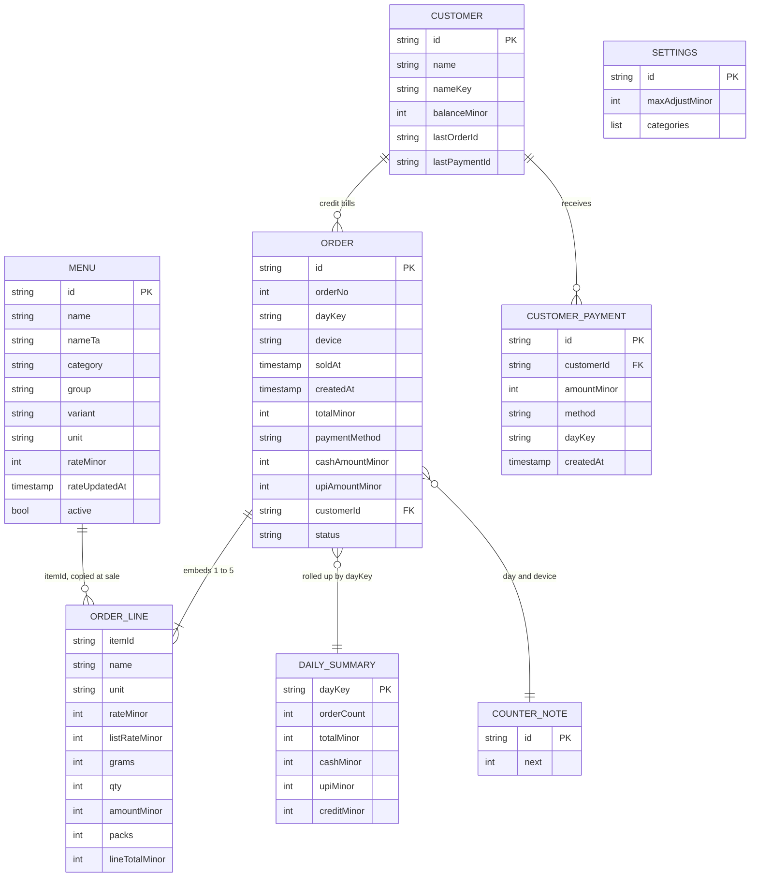
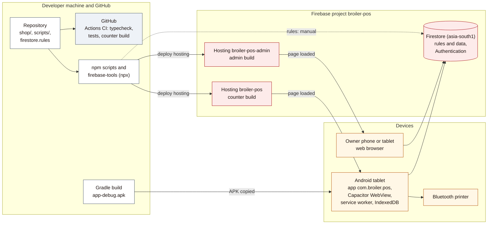

## 1. Executive Summary

**Honey Broilers POS** is a billing system for a chicken and mutton shop. It is built and running as two web applications on one Firebase project (`broiler-pos`), plus an Android wrapper for the counter tablet.

| Part | What it is | Where it lives |
| --- | --- | --- |
| **Counter app** | The cashier's till. Picks products, takes weight, amount or count, builds a bill of up to five lines, takes payment, prints a Tamil bill on a 58 mm Bluetooth printer. Keeps selling with no internet. | `shop/worker-app` (hosted at [broiler-pos.web.app](https://broiler-pos.web.app); packed as an Android app in `shop/worker-app/android`) |
| **Admin site** | The owner's view, in Tamil: today's sales, reports, bills (with delete), the credit book (கடன்), and today's rates. Phone and tablet layouts. | `shop/owner-app` (hosted at [broiler-pos-admin.web.app](https://broiler-pos-admin.web.app)) |
| **Shared library** | Money and weight maths, bill numbers, the offline upload queue, Firestore access. Has all the unit tests. | `shop/shared` (package `@kumbakonam/shared`) |
| **Access rules** | The server-side rules that decide who may read or write what. | `firestore.rules` |
| **Operations scripts** | Local emulators, rules tests, account setup, PIN change, read-only backup. | `scripts/` |

**What makes this system different from a generic POS.** Money is stored as whole paise and weight as whole grams, so totals never drift. Bill numbers are made on the tablet, so a sale never waits for the internet. A sale is written to the tablet first and uploaded by Firestore when the connection allows. The bill is drawn as a picture and printed as a bitmap, which is what lets Tamil text appear on a cheap thermal printer.

**Key facts (verified in the repository on the audit date).**

| Item | Value |
| --- | --- |
| Audit date and commit | 22 October 2026, commit `8ef4588` (branch `main`, 35 commits) |
| Language | TypeScript (strict), React 18.3.1, Vite 6.4.3 |
| Source size | about 13,000 lines of source in `shop/` (TypeScript, TSX, CSS, Java; tests and type-declaration files excluded): counter screens 5,449; printing 1,444; shared library 3,247 (core 1,683, Firestore services 1,197); admin 2,229. Tests add 1,408 lines (unit) and 530 lines (access rules). |
| Automated tests | 139 unit tests (`shop/shared/src/core/*.test.ts`) and 62 access-rule tests (`scripts/rules/firestore.rules.test.mjs`); both suites were run during this audit (Section 15) |
| Live sites | counter and admin both answered HTTP 200 during the audit |
| Status of use | Deployed. Test data was cleared on the audit date (procedure in `docs/GO_LIVE.md`). Whether real sales have been recorded since was not checked, so behaviour under real trading is not evidenced here. |

> **How to read this document.** Every claim cites a file path. Words in the status column mean: **Implemented** (code present and reachable), **Partial** (present with a stated gap), **Not built** (planned or requested, no code), **Unverified** (cannot be proved from the repository). Anything proposed is labelled *Proposed* and is never drawn as part of the current system.

## 2. Business Context and Requirements

The shop sells chicken and mutton by weight, plus a few items by count. The requirements below are taken from the project's own records (`docs/GO_LIVE.md`, `docs/DATA_MODEL.md`, `docs/GAPS.md`, `docs/OFFLINE.md`) and from what the software enforces. There is no separate signed-off requirements specification; the older planning notes in `docs/archive/` describe a different cafe product and are not current.

| Shop reality | What the software does about it | Evidence |
| --- | --- | --- |
| Rates change daily (per kg) | Each menu item has a rate and a "set today" stamp; the admin Rates tab confirms every rate for the day; the dashboard warns when a rate is not set today | `shop/owner-app/src/Rates.tsx`, `shared/src/core/rates.ts` |
| Customers ask for odd quantities: 250 g, "₹150 worth", 3 pieces | Three entry methods per item: weight, amount (money), count; quick tiles for common values; a number pad and wheel for anything else | `worker-app/src/counter/ItemPicker.tsx`, `ItemSheet.tsx` |
| Several of the same pack (2 × 250 g) must read clearly on the bill | Equal packs stay separate as `2 × 250 g` unless the cashier unticks the option | `shared/src/core/sale.ts` (`packGrams`, `packs`) |
| Busy counter, wet hands, one customer after another | Printing happens in the background so the next customer is never blocked; a double tap on a preset is ignored; the gear needs two taps | `worker-app/src/counter/CounterScreen.tsx` |
| Internet drops often | Cash, UPI and split bills are saved on the tablet and uploaded later; an on-screen light shows online or offline | `shared/src/shop/orders.ts`, `outbox.ts`, `connection.ts` |
| Customers buy on credit (கடன்) and pay later | A credit bill needs a customer name and adds to that customer's balance in one server transaction; payments reduce it | `shared/src/shop/orders.ts`, `customers.ts` |
| Part cash, part GPay | A split payment stores the UPI half; cash is the remainder | `shared/src/core/sale.ts` (`splitPayment`) |
| Customers read Tamil | The printed bill is entirely Tamil; the admin site is in Tamil; product names are Tamil | `worker-app/src/printing/receiptCanvas.ts`, `owner-app/src` |
| Cheap 58 mm thermal printer, no cutter | Bill is drawn on a 384-dot canvas and sent as an ESC/POS raster; paper is fed past the tear bar after each bill | `worker-app/src/printing/` |
| The owner is not always in the shop | Admin site on any phone or tablet; sign-in with the managing PIN | `owner-app/src/SignIn.tsx` |
| A wrong bill must be fixable | Delete (voids the bill, marks it, leaves totals) and Fix (delete and reload items) for the newest bills | `worker-app/src/counter/RecentBillsSheet.tsx`, `shared/src/shop/voidOrder.ts` |

## 3. Product Overview and Features

### 3.1 Counter app (Android tablet, landscape)

| Feature | Status | Where |
| --- | --- | --- |
| PIN sign-in that submits at the fourth digit; idle screen lock after 30 minutes; PIN re-entry works offline | Implemented | `counter/PinScreen.tsx`, `shared/src/shop/screenLock.ts` |
| Three tabs (சிக்கன், மட்டன், மற்றவை); product families with photos; cut switch (for example with skin, skinless, live); "Extra" item in every tab | Implemented | `counter/ItemPicker.tsx`, `ItemCards.tsx`, `CounterScreen.tsx` |
| By weight (250, 500, 750 g, 1 kg), by amount (₹100, 150, 200, 300), by count (1 to 4); "Other weight" opens a pad and wheel | Implemented | `counter/ItemPicker.tsx`, `ItemSheet.tsx` |
| Cart of up to five lines; edit and remove a line; same-item merge; "Keep packs separate" | Implemented | `counter/BillCart.tsx`, `counter/cart.ts`, `core/sale.ts` |
| Rate adjustment of ±₹5 steps up to a limit (default ₹20, owner setting `settings/pricing`) | Implemented (in the item sheet) | `counter/ItemSheet.tsx`, `core/sale.ts` |
| Payments: cash, UPI, credit (needs customer and internet), split (cash plus UPI) | Implemented | `counter/BillCart.tsx`, `SplitModal.tsx`, `CreditModal.tsx` |
| Print bill, or Save without printing; chime when a bill is saved | Implemented | `counter/CounterScreen.tsx`, `counter/sound.ts` |
| Background print queue; red strip with Print again for a bill that did not print | Implemented | `counter/CounterScreen.tsx` |
| Recent bills (last 20): print a copy marked நகல், delete or fix the newest 3 | Implemented | `counter/RecentBillsSheet.tsx`, `recentBills.ts` |
| Top bar: online light, bills waiting, printer status (blinks when not connected), clock, gear to the admin site | Implemented | `counter/SideRail.tsx` |
| Bluetooth printer setup: choose from paired devices, test bill | Implemented | `counter/PrinterSheet.tsx`, `printing/classicBluetoothPrinter.ts` |
| Offline selling, bill numbers made on the tablet, upload queue, refused-bill warning | Implemented | `shared/src/shop/billCounter.ts`, `outbox.ts`, `counter/SyncBanner.tsx` |

### 3.2 Admin site (phone and tablet)

| Tab | Status | What it shows or does | Where |
| --- | --- | --- | --- |
| முகப்பு (Dashboard) | Implemented | Today's kilos and money, payment split, week and month, money owed, missing-rates warning | `owner-app/src/Dashboard.tsx` |
| கணக்கு (Reports) | Implemented | Today, yesterday, last 7 days, this month or a date: totals, payment split, chart by hour or day, items sold, by category | `owner-app/src/Reports.tsx` |
| பில் (Bills) | Implemented | The last 4 days; open a bill; owner can delete any bill | `owner-app/src/Bills.tsx` |
| கடன் (Credit) | Implemented | Who owes what; history; take a payment | `owner-app/src/Credit.tsx` |
| விலை (Rates) | Implemented | One row per item; save confirms every rate for today | `owner-app/src/Rates.tsx` |

### 3.3 Not built (stated gaps)

From `docs/GAPS.md` and the code: a menu editor in the admin (items are created by script), expense recording, Excel export, a nightly report by email, scheduled backups (only the manual `npm run backup`), a "hold bill" feature, and an on-screen way to give a second tablet its own counter letter (Section 17, finding M3). Payment services such as GPay are **not integrated**: UPI is only a label on a bill; no money moves through the software.

## 4. User Workflows

### 4.1 Cashier: one sale

1. **Sign in.** Four digits on the keypad; no button. The tablet stays signed in afterwards.
2. **Choose the product.** Tab, then the kind card (for example Broiler), then the cut (with skin, skinless, live).
3. **Choose how to sell.** *By weight* or *By amount*, then tap a preset tile. Anything else: **Other weight**.
4. **Watch the bill.** The cart shows each line with its price. Tap the pencil to edit, the cross to remove. Equal packs show as `2 × 250 g`.
5. **Pick the payment.** Cash, UPI, credit (asks for a customer) or cash plus UPI (asks for the UPI amount).
6. **Print bill** or **Save**. A chime plays, the cart clears at once, and printing runs in the background. If the printer fails, a red strip says the bill is saved but did not print, with a Print again button.
7. **Fix a mistake.** Recent bills, then **Fix** (delete and reload the items) or **Delete**; both need the internet.

### 4.2 Cashier: when the internet drops

The online light turns red after about four seconds. Cash, UPI and split bills carry on. The top bar shows how many bills are waiting. Credit bills, deleting a bill and the admin button explain that they need the internet. When the connection returns the queue uploads by itself.

### 4.3 Owner

Open the admin site, enter the four-digit managing PIN (it signs in by itself), and use the five tabs. In the morning, open **விலை**, set each rate, press **சேமி**; the counter shows the new rates straight away. On the counter, the gear leads to this site after two taps.

## 5. UI/UX and Design System

**Screens.** The counter is one full-screen layout: a slim **top bar**, the **catalog** (tabs, product cards, preset tiles) on the left, and the **bill panel** on the right with payment buttons. Sheets (item entry, split, credit, recent bills, printer, bill preview) slide over it. The admin is a header, one screen at a time, and a tab bar: at the bottom on phones, as a left column on tablets (width 700 px and up) with two-column screens.

**Design tokens.** `shop/shared/src/ui/theme.css` defines the palette and scale used by both apps.

| Token | Value | Use |
| --- | --- | --- |
| `--color-accent` | `#d71920` (red) | Primary actions, brand |
| `--color-secondary` | `#f59e0b` (gold) | Warnings, highlights |
| `--color-bg` / `--color-surface` | `#fffaf2` (cream) / `#ffffff` | Page and cards |
| `--color-text` / muted | `#1f1512` / `#6b5a52` | Text |
| Type scale | 12, 13, 15, 16, 19, 24, 30, 40 px | `--text-*` |
| Radii | 8, 12, 20, 28 px | `--radius-*` |
| Font | Inter (variable, `@fontsource-variable/inter`), then Roboto, system | Latin text. Tamil text uses the system Tamil font. |

A dark token set exists in `theme.css`; both apps set `data-theme="light"` in their `index.html`, so dark mode is defined but not used.

**Touch and layout patterns.**

- Preset tiles are sized with CSS container queries (`cqw`, `cqh`) so that figures never overlap on different tablets (`counter/counter.css`).
- Android's font scaling is locked to 100 percent (`setTextZoom(100)` in `MainActivity.java`) so a large system font cannot push the layout apart.
- The app is full screen with system bars hidden; a swipe from the edge shows them briefly (`MainActivity.java`).
- Feedback: the printer button blinks and rings when no printer is connected; the gear turns into "Tap again for Admin"; a saved bill plays a sound. Animations respect `prefers-reduced-motion`.
- Boot screens show the logo, not a blank page (`index.html` of each app).
- The admin follows the device: single column and bottom tabs under 700 px; side tabs and two columns above (`owner-app/src/app.css`). Its web manifest declares `orientation: portrait` for an installed phone app, while the counter's manifest says `any` (`owner-app/vite.config.ts`, `worker-app/vite.config.ts`).

**Reusable pieces.** Counter: `Keypad`, `WheelPicker`, sheets (`ct-sheet`), `SyncBanner`. Admin: `Sheet`, `Notice`, `BarChart`, `TabIcon` in `owner-app/src/ui.tsx`.

<figure class="diagram"><svg xmlns="http://www.w3.org/2000/svg" viewBox="0 0 700 330" font-family="Segoe UI, Nirmala UI, sans-serif" role="img" aria-label="Counter screen layout"><rect x="0" y="0" width="700" height="330" rx="8" fill="#fbf6ee" stroke="#cdbba7"/><rect x="10" y="10" width="680" height="34" rx="5" fill="#d71920" stroke="#a80f15"/><text x="22" y="31" font-size="12" fill="#ffffff" text-anchor="start" font-weight="700">HONEY BROILERS</text><text x="680" y="31" font-size="10" fill="#ffffff" text-anchor="end">bills waiting  |  online light  |  printer  |  recent bills  |  clock  |  gear</text><rect x="10" y="52" width="430" height="268" rx="4" fill="#ffffff" stroke="#d71920"/><rect x="18" y="60" width="414" height="26" rx="4" fill="#fdebea" stroke="#d71920"/><text x="225" y="77" font-size="12" fill="#1f1512" text-anchor="middle">சிக்கன்      |      மட்டன்      |      மற்றவை</text><rect x="18" y="94" width="110" height="218" rx="4" fill="#ffffff" stroke="#cdbba7"/><rect x="24" y="100" width="98" height="62" rx="4" fill="#fbf6ee" stroke="#cdbba7"/><text x="73" y="124" font-size="10" fill="#1f1512" text-anchor="middle" font-weight="700">Kind card</text><text x="73" y="140" font-size="9.5" fill="#6b5a52" text-anchor="middle">photo, name, rate</text><rect x="24" y="170" width="98" height="62" rx="4" fill="#fbf6ee" stroke="#cdbba7"/><text x="73" y="194" font-size="10" fill="#1f1512" text-anchor="middle" font-weight="700">Kind card</text><text x="73" y="210" font-size="9.5" fill="#6b5a52" text-anchor="middle">photo, name, rate</text><rect x="24" y="240" width="98" height="62" rx="4" fill="#fbf6ee" stroke="#cdbba7"/><text x="73" y="264" font-size="10" fill="#1f1512" text-anchor="middle" font-weight="700">Kind card</text><text x="73" y="280" font-size="9.5" fill="#6b5a52" text-anchor="middle">photo, name, rate</text><rect x="136" y="94" width="296" height="218" rx="4" fill="#ffffff" stroke="#cdbba7"/><text x="284" y="111" font-size="11" fill="#1f1512" text-anchor="middle" font-weight="700">Item name and today's rate</text><rect x="144" y="120" width="280" height="24" rx="4" fill="#fbf6ee" stroke="#cdbba7"/><text x="284" y="136" font-size="10.5" fill="#1f1512" text-anchor="middle">Cut switch:  With skin  |  Skinless  |  Live</text><rect x="144" y="150" width="280" height="24" rx="4" fill="#fbf6ee" stroke="#cdbba7"/><text x="284" y="166" font-size="10.5" fill="#1f1512" text-anchor="middle">By weight  |  By amount</text><rect x="144" y="182" width="138" height="40" rx="4" fill="#ffffff" stroke="#d71920"/><text x="213" y="207" font-size="14" fill="#1f1512" text-anchor="middle" font-weight="700">250 g</text><rect x="286" y="182" width="138" height="40" rx="4" fill="#ffffff" stroke="#d71920"/><text x="355" y="207" font-size="14" fill="#1f1512" text-anchor="middle" font-weight="700">500 g</text><rect x="144" y="228" width="138" height="40" rx="4" fill="#ffffff" stroke="#d71920"/><text x="213" y="253" font-size="14" fill="#1f1512" text-anchor="middle" font-weight="700">750 g</text><rect x="286" y="228" width="138" height="40" rx="4" fill="#ffffff" stroke="#d71920"/><text x="355" y="253" font-size="14" fill="#1f1512" text-anchor="middle" font-weight="700">1 kg</text><rect x="144" y="274" width="280" height="30" rx="4" fill="#fbf6ee" stroke="#cdbba7"/><text x="284" y="293" font-size="10.5" fill="#1f1512" text-anchor="middle">Other weight</text><rect x="450" y="52" width="240" height="268" rx="4" fill="#fff7e6" stroke="#b45309"/><text x="462" y="70" font-size="12" fill="#1f1512" text-anchor="start" font-weight="700">Bill</text><rect x="458" y="78" width="224" height="92" rx="4" fill="#ffffff" stroke="#cdbba7"/><text x="570" y="118" font-size="10.5" fill="#1f1512" text-anchor="middle" font-weight="700">Bill lines (up to 5)</text><text x="570" y="134" font-size="10" fill="#6b5a52" text-anchor="middle">edit, remove</text><text x="462" y="188" font-size="10.5" fill="#1f1512" text-anchor="start">[x]  Keep packs separate</text><text x="462" y="210" font-size="11" fill="#1f1512" text-anchor="start" font-weight="700">Total</text><rect x="458" y="220" width="140" height="28" rx="4" fill="#d71920" stroke="#a80f15"/><text x="528" y="238" font-size="11" fill="#ffffff" text-anchor="middle" font-weight="700">Print bill</text><rect x="604" y="220" width="78" height="28" rx="4" fill="#ffffff" stroke="#a80f15"/><text x="643" y="238" font-size="11" fill="#1f1512" text-anchor="middle" font-weight="700">Save</text><rect x="458" y="256" width="110" height="26" rx="4" fill="#ffffff" stroke="#b45309"/><text x="513" y="273" font-size="10.5" fill="#1f1512" text-anchor="middle">Cash</text><rect x="572" y="256" width="110" height="26" rx="4" fill="#ffffff" stroke="#b45309"/><text x="627" y="273" font-size="10.5" fill="#1f1512" text-anchor="middle">UPI</text><rect x="458" y="286" width="110" height="26" rx="4" fill="#ffffff" stroke="#b45309"/><text x="513" y="303" font-size="10.5" fill="#1f1512" text-anchor="middle">Credit</text><rect x="572" y="286" width="110" height="26" rx="4" fill="#ffffff" stroke="#b45309"/><text x="627" y="303" font-size="10.5" fill="#1f1512" text-anchor="middle">Cash + UPI</text></svg><figcaption>Figure 1. Counter screen layout, a schematic drawn from SideRail.tsx, ProductGrid.tsx, ItemPicker.tsx and BillCart.tsx (not a screenshot).</figcaption></figure>

## 6. Technology Stack

Versions below are the resolved versions in `shop/package-lock.json` unless stated.

| Technology | Version | Purpose | Where used |
| --- | --- | --- | --- |
| TypeScript | 5.9.3 | Language, strict type checking | all of `shop/` |
| React / React DOM | 18.3.1 | User interface | `worker-app`, `owner-app`, `shared` |
| Vite | 6.4.3 | Build and dev server | `worker-app/vite.config.ts`, `owner-app/vite.config.ts` |
| `@vitejs/plugin-react` | 4.7.0 | React in Vite | both apps |
| `vite-plugin-pwa` (Workbox 7.4.1) | 1.3.0 | Service worker, manifest, offline file cache | both apps |
| Firebase JS SDK | 11.10.0 (apps); 13.1.0 (root scripts) | Auth, Firestore | `shared/src/firebase`, `shared/src/shop`; `scripts/` |
| Capacitor core / Android / CLI | 8.5.0 | Android shell around the hosted site | `worker-app/capacitor.config.ts`, `android/` |
| `@fmesasc/capacitor-bluetooth-serial` | 6.0.3 | Classic Bluetooth serial (SPP) to the printer | `printing/classicBluetoothPrinter.ts` |
| Custom plugin `PairedPrinters` | in repo | Lists already-paired Bluetooth devices | `android/app/src/main/java/com/broiler/pos/PairedPrintersPlugin.java` |
| `@fontsource-variable/inter` | 5.3.0 | Interface font | `worker-app/src/main.tsx` |
| Node.js | 24 (CI); 24.17.0 on the audit machine | Runs tests and scripts (`node --test`, built-in type stripping) | `.github/workflows/ci.yml` |
| Android | minSdk 24; compile and target 36; Android Gradle Plugin 8.13.0; Gradle 8.14.3; JDK 21 (as used by the build script) | APK build | `worker-app/android/variables.gradle`, `build.gradle` |
| Firebase CLI | run with `npx firebase-tools` (version not pinned) | Hosting and rules deploy, emulators | `shop/package.json`, `scripts/run-emulators.mjs` |
| `@firebase/rules-unit-testing` | 6.0.0 | Access-rule tests | `scripts/rules/` |

There is no state-management library: React state, `useReducer` for the cart (`counter/cart.ts`), and `useSyncExternalStore` for the upload queue and recent bills. There is no router: each app is a single screen with internal state. No own backend server or REST API exists; both apps talk directly to Firebase.

## 7. Codebase Structure

```text
firebase.json, firestore.rules, .firebaserc   deploy configuration (two hosting sites, rules, emulators)
shop/                                         the product (npm workspaces: shared, worker-app, owner-app)
  shared/src/core/      pure TypeScript: sale maths, bill numbers, outbox, PIN lock, summaries (with the unit tests)
  shared/src/shop/      Firestore services: orders, customers, menu, void, owner reads, session, screen lock
  shared/src/firebase/  Firebase init (persistent cache for the counter, memory cache for the admin)
  shared/src/ui/        theme.css (design tokens)
  worker-app/src/counter/   counter screens and components
  worker-app/src/printing/  bill drawing, ESC/POS raster, Bluetooth printers
  worker-app/android/       Capacitor Android project (MainActivity, PairedPrintersPlugin)
  owner-app/src/            admin screens
  scripts/              asset and Android build tools
scripts/                operations: emulators, rules tests, accounts, menu seed, checks, backup
docs/                   guides; docs/archive = old planning notes; docs/project-documentation = this document
.github/workflows/ci.yml   typecheck, tests and build of the shop apps
```

| Key module | Responsibility |
| --- | --- |
| `shared/src/core/sale.ts` | All sale maths and cart rules: pricing, rounding, merging, limits, split, formatting |
| `shared/src/core/outbox.ts`, `billNo.ts` | Upload queue state; bill label and per-day numbering |
| `shared/src/core/roles.ts`, `pinLock.ts` | Account emails, PIN to password, lockout and local PIN check |
| `shared/src/shop/orders.ts` | `createOrder`: validate, price, number, write |
| `shared/src/shop/voidOrder.ts`, `customers.ts` | Delete a bill; take a credit payment (transactions) |
| `shared/src/shop/ownerData.ts` | Owner reads; roll-up of old days into daily totals |
| `worker-app/src/counter/CounterScreen.tsx` | The counter's hub: state, sale saving, print queue, sheets |
| `worker-app/src/printing/receiptCanvas.ts`, `escposRaster.ts` | Draw the bill; convert to printer bytes |
| `owner-app/src/data.ts` | Admin data loading (on demand, no live listeners) |
| `firestore.rules` | Server-side validation and permissions |

## 8. System Architecture

The system has no server of its own. Both applications are static web builds served by Firebase Hosting, talking to Firestore and Auth directly from the browser. Everything that must be trusted is enforced by the Firestore rules.



**Layers.** The code is layered so that the money rules sit in one pure module.



**Runtime split.** The counter uses Firestore with a persistent local cache (IndexedDB, multi-tab) so reads and writes work offline (`shared/src/firebase/config.ts`, `initFirebase({ offlinePersistence: true })` in `worker-app/src/main.tsx`). The admin uses a memory cache and reads on demand (`offlinePersistence: false`).

## 9. Component Architecture

`CounterScreen.tsx` is the hub of the counter: it owns the cart, payment choice, sheets, sale saving and print queue, and passes data down as props. The admin is simpler: `Shell.tsx` holds the tab state and `useOwnerData` supplies figures to the five screens.



**Admin components.** `App.tsx` chooses `SignIn` or `Shell`; `Shell.tsx` shows `Dashboard`, `Reports`, `Bills`, `Credit` or `Rates`; all read through `useOwnerData` (`data.ts`), which calls `shared/src/shop/ownerData.ts`, `customers.ts` and `menu.ts`. Shared admin widgets are in `ui.tsx` and formatting in `fmt.ts`.

## 10. Data Flow

### 10.1 From product to bill

Plain English: a tap on a preset tile becomes a *line* (item, rate, grams or count, optionally an exact amount). The cart merges equal lines and totals them. Technically, every path ends in the same functions in `shared/src/core/sale.ts`.



### 10.2 Billing and payment sequence

`charge()` in `CounterScreen.tsx` drives the sequence. Cash, UPI and split bills do not wait for the server. A credit bill is a server transaction and is refused offline.



### 10.3 Offline save and upload

A sale made with no connection is not lost or held back: Firestore keeps the write in the tablet's cache and sends it when it can. The *upload queue* (`shared/src/shop/outbox.ts`, rules in `shared/src/core/outbox.ts`) is how the screen knows what is still waiting. It is stored in `localStorage` (`broiler.outbox`), so bills waiting when the app is closed are picked up again on the next start (`resumeOutbox`).

| State | Meaning | How it is detected | What the cashier sees |
| --- | --- | --- | --- |
| Pending | Saved on the tablet, not yet acknowledged by the server | The order document exists and `hasPendingWrites` is true (`classifySale`) | A gold "N waiting" pill in the top bar |
| Confirmed | The server has the bill | The write's promise resolves, or the document is no longer pending | The bill leaves the queue; the pill goes away |
| Rejected | The server refused the bill (for example a rule failed) | The write's promise rejects, or the document vanishes while the server is reachable | A red card naming the bill, its amount and what was sold; stays until "Got it" is pressed |
| Stale | Pending for 24 hours or more (`STALE_WARNING_MS`) | Age of the oldest pending sale | The pill turns red and a note asks for the internet |
| Expired | Pending beyond 3 days plus one day of slack | `dropExpired` | Forgotten locally; the rules would refuse such a sale anyway (`MAX_SALE_AGE_MS`) |

The queue is kept per signed-in account (`uid` on each entry), so while a different account is signed in a waiting sale is simply out of view and nothing is concluded about it.

## 11. Business Logic and Calculations

All figures are verified from `shop/shared/src/core/sale.ts` and the rules in `firestore.rules`. Money is whole paise (`24000` is ₹240.00); weight is whole grams.

| Rule | Implementation | Notes |
| --- | --- | --- |
| Weight line price | `lineTotalMinor = Math.round(rateMinor × grams / 1000)` | Rounds to the nearest paisa; halves round up. Example: 500 g at ₹240.00/kg gives 12,000 paise (₹120.00). |
| Count line price | `pieceTotalMinor = rateMinor × qty` | No rounding needed. |
| Amount line | `orderLineTotalMinor` returns `amountMinor` exactly | The line charges the amount typed; the weight is only what to weigh out. |
| Weight for an amount | `gramsForAmount = Math.round(amountMinor × 1000 / rateMinor)` | 0 if the rate is 0. Example: ₹150 at ₹240/kg gives 625 g. |
| Cart total | `cartTotals`: sum of line totals, grams and pieces | Integer sums. |
| Merge | Same `itemId`, same `rateMinor`, same `listRateMinor`, same `packGrams` | Amount lines add their amounts; packs add their pack count. |
| Packs | `packGrams` and `packs`; `2 × 250 g` displayed; price equals one line of the total weight | Controlled by "Keep packs separate". |
| Limits | 5 lines (`MAX_ORDER_LINES`), count up to 999 (`MAX_QTY`), weight up to 999,999 g (`MAX_LINE_GRAMS`) | The 5-line limit must match the rules file (see below). |
| Rate adjustment | Step ₹5 (`ADJUST_STEP_MINOR = 500`), limit default ₹20 (`DEFAULT_MAX_ADJUST_MINOR = 2000`), `clampRate` keeps the rate within the limit and above 0 | Rate changes on an amount line recompute its grams. |
| Split | `splitPayment`: only the UPI half is stored; cash is the remainder; UPI is held between 0 and the total | A split with nothing on one side is refused (`isRealSplit`). |
| Credit | `customerIdFromName`: trimmed, lower-cased, spaces collapsed, URL-encoded | "Ravi Stores" and "ravi  stores" are one customer. A payment may not exceed the balance (`paymentProblem`). |
| Money display | `formatMoney`: `₹` plus Indian digit grouping, two decimals | `toLocaleString('en-IN')`. |
| Bill number | `billLabel`: `dd-mm/number`, counter A prints the number alone, another counter prefixes its letter | Example `22-10/12`; numbers restart at 1 each day per counter. |

**Server-side checks.** `firestore.rules` repeat the money rules. For each of up to five lines the rules check that the rate is within the owner's limit of the list rate, that a line is a weight or a count, and that its total equals rate × quantity. For weight lines the rules accept a total within **1 paisa** of the rounded value, so the server tolerates minor rounding differences; the sum of line totals must equal the bill total, and the two halves of a split must add up. Rules cannot loop, so the five lines are checked at fixed positions: the 5-line limit exists because of this (`shared/src/core/sale.ts` comment on `MAX_ORDER_LINES`).

**Edge cases handled.** A rate of 0 gives 0 g for an amount. Quantities and weights are capped when merged. A retry of the same sale reuses its order id and bill number, so it cannot be saved twice (`reserveBillNo`, `createOrder`). A bill dropped before saving gives its number back (`abandonBillNo`). The bill and the screen use the same formatted strings.

## 12. Database and Persistence

**Cloud Firestore** (region `asia-south1`) is the only server-side store. There are no migrations; collections are created by use and shaped by the rules. The ER diagram shows the logical relationships; Firestore enforces none of them as foreign keys, the rules check specific links (for example a credit bill's customer).



| Collection | Key | Written by | Rules (summary) |
| --- | --- | --- | --- |
| `menu` | item id | owner (seed script, Rates tab) | counter and owner read; only owner writes; rate must be a positive integer |
| `settings/pricing`, `settings/categories` | fixed ids | owner | staff read; owner writes within limits |
| `orders` | id made on the tablet | counter, owner | create only if `validOrder()`; owner lists and reads; only the owner can list; the counter may read a single order by id if it was created in the last 24 hours (used to retry a sale and to delete a recent bill); update only to mark void; delete only the owner, after 3 days, once the day's summary exists |
| `customers` | derived from name | server transaction | never deleted; balance changes only together with a matching order, payment or void |
| `customerPayments` | id made by the client | admin site (the rules also allow the counter) | append-only; only the owner reads |
| `dailySummaries` | `YYYY-MM-DD` | admin site | written once, never changed |
| `counters` | `<day>_<device>` | counter (written with each bill) | staff read and write; holds `next`; a hint for a reinstalled tablet |

**Local storage on the tablet** (browser `localStorage` unless noted): `broiler.device` (counter letter), `broiler.billNumbers`, `broiler.outbox` (unsent sales), `broiler.recentBills` (last 20), `broiler.deletedBills`, `broiler.printer`, `broiler.locked`, `broiler.lastActiveAt`, `broiler.pinChecks` (salted PBKDF2 hashes for offline unlock), `broiler.pinAttempts`; the Firestore offline cache (IndexedDB); the service-worker file cache. The admin keeps `broiler.owner.pinAttempts` and `broiler.owner.rollUpDay`.

**Data lifecycle.** Bills are kept in full for 4 days (`KEEP_DAYS` in `core/dateRange.ts`). The admin, at most once a day, saves each older day as one `dailySummaries` record and then removes that day's bills (`shop/ownerData.ts: rollUpOldDays`); the rules refuse to remove a bill whose day has no summary. A deleted bill is marked `voided` and stays. Customers are never deleted. After roll-up, per-bill detail older than 4 days no longer exists in the database (only the daily totals); this is a deliberate design to stay within the free plan and is a record-keeping limit (Section 17).

## 13. APIs and Integrations

There is no custom API. The integrations below are all verified in code.

| Integration | How it works | Where |
| --- | --- | --- |
| **Firebase Authentication** | Email and password. Two fixed accounts, `owner@broiler-pos.invalid` and `counter@broiler-pos.invalid`; the password is `broiler-` plus the PIN (4 to 6 digits). The role is read from the email. | `shared/src/core/roles.ts`, `shared/src/shop/session.ts` |
| **Cloud Firestore** | Client SDK 11.10.0; counter with persistent cache and multi-tab manager, admin with memory cache; emulator support in development only | `shared/src/firebase/config.ts` |
| **Firebase Hosting** | Two sites from `firebase.json`: `broiler-pos` serves `shop/worker-app/dist`, `broiler-pos-admin` serves `shop/owner-app/dist`; SPA rewrite; `X-Robots-Tag: noindex, nofollow`; `no-cache` on HTML and service-worker files; long immutable caching for hashed assets | `firebase.json` |
| **Bluetooth printer (Android)** | Classic Bluetooth serial through `@fmesasc/capacitor-bluetooth-serial`; the printer is chosen from the tablet's paired devices (custom `PairedPrinters` plugin); one write of the whole bill; one automatic reconnect and resend | `printing/classicBluetoothPrinter.ts`, `core/printRecovery.ts` |
| **Bluetooth printer (browser)** | Web Bluetooth (BLE) fallback for desktop testing | `printing/webBluetoothPrinter.ts` |
| **ESC/POS raster** | The bill is drawn on a canvas 384 dots wide (58 mm paper at the 0.82 scale of the 80 mm design), converted to 1-bit with a luminance threshold of 160, sent in bands of 128 rows with `GS v 0`; blank runs of 5 rows or more are fed past with `ESC J` instead of sent; about 20 mm is fed after the bill (the printer has no cutter) | `printing/receiptCanvas.ts`, `escposRaster.ts`, `shopDetails.ts` |
| **Android shell** | Capacitor loads the hosted counter site (`server.url`); `CAP_LOCAL=1` bundles it instead. `MainActivity` keeps the screen on, goes full screen and locks font zoom. Permissions in the merged manifest: `INTERNET`, `BLUETOOTH_CONNECT`, `BLUETOOTH_SCAN`, location (declared by the Bluetooth plugin). | `worker-app/capacitor.config.ts`, `android/` |
| **UPI / GPay** | **Not integrated.** UPI is a payment label stored on the bill. | `shared/src/core/types.ts` |

**Printer hardware.** The documentation names a BonKaso BKT05 printer (`docs/PRINTING.md`); the model itself cannot be verified from the repository.

### 13.1 From print queue to paper

Plain English: the bill is drawn as a picture, turned into black and white dots, and sent to the printer in one piece. Technically, in order (`worker-app/src`):

| Step | What happens | File |
| --- | --- | --- |
| 1. Format | `toBillInput` turns the saved sale into text: every quantity, rate and total is already formatted in Tamil (for example `2 × 250 கிராம்`), plus the payment label and, for credit, the customer name | `counter/bill.ts` |
| 2. Draw | `prepareReceiptRaster` draws logo, items, totals, payment, bill number and date on a canvas 384 dots wide using the system Tamil font; a copy is marked நகல் | `printing/receiptCanvas.ts` |
| 3. Reduce to dots | `packRaster` makes one bit per dot: a pixel darker than luminance 160 is ink, transparent is paper | `printing/escposRaster.ts` |
| 4. Build the bytes | initialise (`ESC @`), set units (`GS P`), centre (`ESC a 1`); ink in bands of at most 128 rows (`GS v 0`); blank stretches of 5 rows or more fed with `ESC J`; left align; feed 160 dots (about 20 mm); `GS V 0` (a cut command that printers without a cutter ignore) | `printing/escposRaster.ts` |
| 5. Send | `printWithRecovery`: check the link, connect if needed, write all bytes at once; on a failure that a fresh connection could cure, disconnect, reconnect and resend once | `core/printRecovery.ts`, `printing/classicBluetoothPrinter.ts` |
| 6. Report | Result is one of: printed, Bluetooth off, permission refused, or unreachable. A failure puts the bill on the red "did not print" strip and the printer button blinks | `hooks/usePrinter.ts`, `counter/CounterScreen.tsx` |

Each print is queued behind the previous one (`queuePrint`), so two bills never write to the printer at the same time. The paper layout is drawn at 80 mm proportions and scaled by 0.82 for 58 mm paper (`SCALE` in `receiptCanvas.ts`).

## 14. Security and Reliability

### 14.1 Verified controls

- **Server-side authorization.** Every Firestore request is checked by `firestore.rules`; anyone who signs up with the public API key has neither account email and is refused everywhere (`emailIs`). `shop/shared/src/shop/session.ts` signs out any other account.
- **Append-only sales.** Bills cannot be edited except to mark them void; the rules check line totals, split halves, credit customer, sale time (not in the future, not more than 3 days old), and exact key sets.
- **Credit integrity.** A customer's balance can only change in the same transaction as a matching order, payment or void.
- **PIN protection.** The admin sign-in and the counter's screen unlock block for 30 seconds after 5 wrong PINs (`pinLock.ts`: `FREE_ATTEMPTS = 5`, `BLOCK_MS = 30000`, counted in the browser). The counter's first sign-in screen has no limit of its own; Firebase Authentication adds its own rate limiting to every sign-in. The offline screen-lock check stores a salted PBKDF2-SHA-256 hash (100,000 iterations), never the PIN.
- **Secrets.** Firebase web configuration comes from `.env` files, which are git-ignored (`.gitignore`); PINs are never in files (scripts ask for them without echo); `backups/` is ignored.
- **Hosting.** `noindex` header; no-cache for entry files; HTTPS through Hosting and `androidScheme: https` for the shell.

### 14.2 Reliability mechanisms

- **Offline-first sales** with a persisted upload queue that survives closing the app; a sale older than 3 days is refused by the rules (`MAX_SALE_AGE_MS`).
- **Idempotency.** One order id per sale kept across retries; credit retries find the existing order.
- **Print recovery.** A dead Bluetooth link is reconnected once and the bill resent; failures are classified (Bluetooth off, permission, unreachable) and shown; the bill stays saved (`printRecovery.ts`).
- **Connection truth.** The online light is driven by Firestore's own cache-versus-server signal, not only the browser's flag, with a 4-second grace (`shared/src/shop/connection.ts`).
- **Error mapping.** `describeError` turns Firebase errors into short messages; raw text never reaches the screen (admin shows Tamil equivalents).

### 14.3 Limitations (see Section 17 for priorities)

PINs are 4 digits and are the Firebase passwords; lockouts are client-side; the Android manifest allows backup; the bill is "printed" when the bytes are written, not when paper emerges (printers rarely report paper-out); a wrong tablet clock can place a sale on the wrong day within the 3-day window.

## 15. Testing and Quality Assurance

| Check | Command | Scope | Result on the audit date |
| --- | --- | --- | --- |
| Unit tests | `cd shop && npm test` (runs `node --test` on `shared/src/core/*.test.ts`) | 12 files; sale maths 57 tests, summaries 13, bill numbers 12, outbox 12, date ranges 10, print recovery 10, PIN lock 6, categories 5, recent bills 5, roles 4, errors 3, rates 2 = **139** | **139 passed, 0 failed** (run during this audit) |
| Access-rule tests | `npm run test:rules` (repository root; starts the Firestore emulator) | 62 tests in `scripts/rules/firestore.rules.test.mjs`: roles, order validation, credit, void, payments, summaries | **62 passed, 0 failed** (run during this audit) |
| Type checking | `cd shop && npm run typecheck` | shared, counter, admin (`tsc --noEmit`) | **Passed** (run during this audit) |
| Production build | `cd shop && npm run build` | counter and admin Vite builds | **Passed** (run during this audit) |
| Continuous integration | `.github/workflows/ci.yml` | typecheck, unit tests and counter build on every push and pull request | Workflow present; **its runs on GitHub were not inspected** |
| Live access check | `npm run check:access` | Real accounts against the live project; **creates test records** | Not run (it writes to the live database) |

**Not covered by automated tests.** React components and screens, the admin site, printing and Bluetooth (needs hardware), the Android native code, the outbox against a real network, and the hosting configuration. There is no end-to-end browser test. The counter's recent behaviour was exercised manually against the local emulator during development; those checks are not repeatable from the repository.

## 16. Build, Configuration and Deployment

**Prerequisites.** Node.js 24, npm; for Android: a JDK (the build script uses JDK 21 from `.tools/jdk21` when present) and the Android SDK (the build script finds `JAVA_HOME`, the project's `.tools/jdk21`, or Android Studio's JDK).

**Configuration.** Copy `shop/worker-app/.env.example` to `.env` (and the same for `shop/owner-app`) with the six `VITE_FIREBASE_*` values from the Firebase console. `.env.emulator` files exist for local emulator mode. The operations scripts read `shop/worker-app/.env`.

| Task | Command | What it does (verified in `shop/package.json`, root `package.json`) |
| --- | --- | --- |
| Install | `cd shop && npm install`; repository root `npm install` | Apps; operations tools |
| Develop | `npm run dev:worker`, `npm run dev:owner` | Vite dev servers (counter on port 3000, admin on 3003) |
| Emulate | `npm run emulators`, `npm run emulators:seed`, `npm run dev:emulator` (root) | Local Firestore and Auth with the real rules; test PINs |
| Deploy counter | `cd shop && npm run deploy:counter` | Build, then `firebase deploy --only hosting:broiler-pos --config ../firebase.json --project broiler-pos` |
| Deploy admin | `cd shop && npm run deploy:owner` | Same for `hosting:broiler-pos-admin` |
| Android APK | `cd shop && npm run android:apk` | Vite build, Capacitor sync, Gradle; writes `worker-app/android/app/build/outputs/apk/debug/app-debug.apk` (debug-signed) |
| Backup | `npm run backup` (root) | Read-only JSON copy of every collection into `backups/` |

**Firestore rules.** `firebase.json` names `firestore.rules`, but no npm script deploys them; the project documents that the rules were deployed with the Firebase CLI. The exact command used is **unverified**. Deploying rules is a manual `firebase deploy --only firestore:rules` step (not scripted).

**Updating the tablet.** The Android shell loads the hosted site, so a counter deploy reaches the tablet without a reinstall. A new APK is only needed when native Android code changes (`MainActivity.java`, plugins, manifest, launch images).



## 17. Technical Findings and Recommendations

These are observations about the current repository. They are separate from the implemented functionality above. Priority reflects likely effect on a working shop.

| ID | Priority | Finding (evidence) | Recommendation |
| --- | --- | --- | --- |
| H1 | High | **Auto-submit blocks longer PINs.** The PIN screens submit at 4 digits (`counter/PinScreen.tsx`, `owner-app/src/SignIn.tsx`), while the PIN rules allow 4 to 6 (`core/roles.ts`). A 5 or 6 digit PIN can no longer be entered. | Decide: keep 4-digit PINs, or submit on a button or when the digit count is known. |
| H2 | High | **Low-entropy credentials.** The PIN is the Firebase password (`broiler-<PIN>`); 4 digits give 10,000 possibilities. The 5-try lockout (`pinLock.ts`) is counted in the browser, covers only the admin sign-in and the counter's unlock screen, and can be bypassed by clearing storage; the counter's first sign-in has no such limit. Only Firebase's own throttling is server-side. | Use 6-digit PINs at least for the owner; consider Firebase App Check and a server-enforced lockout. |
| M1 | Medium | **Backups are manual.** `npm run backup` exists; there is no scheduled backup (`docs/GAPS.md`). Data older than 4 days exists only as daily totals. | Schedule exports; decide how long per-bill detail must be kept. |
| M2 | Medium | **Android `allowBackup="true"`** in the merged manifest: app data (local bills, outbox) may be included in device backups. | Set `allowBackup="false"` and rebuild the APK. |
| M3 | Medium | **Counter letter has no screen.** `setDeviceLetter` (`shared/src/shop/billCounter.ts`) has no caller; the Admin menu that offered it was removed. A second tablet would print letter A. | Add a setting in the admin or counter before a second tablet is used. |
| M4 | Medium | **Printed does not mean paper out.** The bill is marked printed after the bytes are written; printers rarely report paper end or cover open (`printRecovery.ts` comment). | Keep the Recent bills copy; consider a printer status query if the model supports it. |
| M5 | Medium | **Tablet clock trust.** `soldAt` and the day key use the tablet's clock; the rules bound it to 3 days. A wrong clock files a sale under the wrong day. | Keep automatic date and time on; consider showing a warning when the clock differs from the server. |
| M6 | Medium | **CI does not run the rules tests, and rules deployment is manual.** The security rules are the main boundary (`ci.yml`, `package.json`). | Add a rules-test job (needs Java) and a scripted rules deploy. |
| L1 | Low | **Documentation drift.** `firestore.rules` header says "at most 20 lines" and cites `packages/shared/src/roles.ts`; `core/sale.ts` mentions a "21st line" (limit is 5); `docs/OFFLINE.md` still mentions the Admin menu. | Correct the comments and the guide. |
| L2 | Low | **Unused helpers.** Not used by the apps or other shared files (a search found uses only inside `sale.ts`; each is exercised by `sale.test.ts`): `stepUpGrams`, `stepDownGrams`, `meterGramsFromX`, `meterXFromGrams`, `wheelIndexFromOffset`, `wheelMaxOffset`, `stepUpQty`, `stepDownQty`, `parseRateInput`, `formatRateInput`, `applyRateKey`, `parseQtyInput`, `applyQtyKey`, `adjustLine`, `isValidRupeesInput` (found by search; remnants of an earlier prototype). | Remove with their tests if confirmed unneeded. |
| L3 | Low | **Mixed Firebase SDK versions.** Apps use 11.10.0, root scripts use 13.1.0 (rules-unit-testing requires 13). | Align when upgrading. |
| L4 | Low | **Debug APK.** The APK is debug-signed (`build-android.mjs`) and is installed by copying the file. | Create a signed release build before wider distribution. |
| L5 | Low | **Receipt preview page** at `/?receipt` is reachable without sign-in; it shows sample bills only (`worker-app/src/main.tsx`). | Remove from production or gate it. |
| L6 | Low | **First launch needs the internet.** The shell loads the hosted site; the service worker caches it after the first load (`capacitor.config.ts` comment). | Install once with the internet on; or build with `CAP_LOCAL=1` to bundle. |
| L7 | Low | **No UI or end-to-end tests,** and the admin has no automated tests (Section 15). | Add component tests for the cart and an end-to-end test of a sale against the emulator. |

## 18. Developer Reference

**Where to change common things.**

| To change | Edit | Also update |
| --- | --- | --- |
| Shop name or bill footer | `worker-app/src/printing/shopDetails.ts` | |
| Paper width | `PAPER_WIDTH_DOTS` in `shopDetails.ts` (384 for 58 mm, 576 for 80 mm) | Test print on the printer |
| Maximum lines per bill | `MAX_ORDER_LINES` in `core/sale.ts` | **`firestore.rules`** (`linesOk`, `sumOf`) and the tests; they must change together |
| Add a payment method | `core/types.ts`, `BillCart.tsx`, `orders.ts` | `firestore.rules` (`paymentMethod in [...]`), summaries, rules tests |
| Rate adjustment limit | Owner setting `settings/pricing` (default in `core/sale.ts`) | |
| Add or change a menu item | `scripts/seed-menu.mjs` or Firestore (no editor screen) | Photos in `worker-app/public/families` and `public/items` |
| Counter tab names | `TAB_NAMES` in `CounterScreen.tsx` | |
| Admin Tamil words | `owner-app/src/*.tsx` | |
| Colours and fonts | `shared/src/ui/theme.css` | |

**Operational commands (repository root).** `npm run test:rules`, `npm run emulators`, `npm run emulators:seed`, `npm run backup`, `node --env-file=shop/worker-app/.env scripts/change-pin.mjs owner`, `scripts/set-category.mjs`, `scripts/check-books.mjs`.

**Guides.** `docs/GO_LIVE.md` (accounts, first day, clearing test data), `docs/OWNER_APP.md`, `docs/PRINTING.md`, `docs/OFFLINE.md`, `docs/TESTING.md`, `docs/DATA_MODEL.md`, `docs/STAFF_GUIDE_TA.md` (cashier guide in Tamil), `docs/GAPS.md`.

**Maintenance cautions.** Keep `core/` free of runtime imports from sibling files (the tests load it directly under Node). Money is always paise and weight grams; format only at the edge. Changing the order shape means changing `orders.ts`, `firestore.rules`, `ownerData.ts` and the rules tests together. The counter and the admin share Firebase accounts, not browser storage: they are different web origins.

## 19. Documentation Verification and Conclusion

**Method.** The document was written from the repository at commit `8ef4588`. A separate verification pass then compared its statements with the source (summarised below; full list in `Verification_Report.md`). The tests, type check and builds named in Section 15 were run during the audit; the live database and the Android hardware were not exercised.

| Check | Outcome |
| --- | --- |
| Library names and versions against `shop/package-lock.json` and manifests | Matched; Firebase SDK versions differ between the apps (11.10.0) and root scripts (13.1.0), stated in Section 6 |
| Formulas against `sale.ts` and the rules | Matched; the rules' 1 paisa tolerance and the 5-line limit stated |
| Data model against `firestore.rules`, `orders.ts`, `ownerData.ts` | Matched; relationships shown are logical, not enforced keys |
| Commands against `package.json` files and scripts | Matched; rules deployment has no script |
| Diagrams against imports and call paths | Matched to the files named; component names are the same throughout |
| Counts (tests, files, lines) | Re-counted from the repository |

**Known limitations of this document.** It cannot show how the system behaves under real trading, how the printer behaves on paper, or the contents of the live database. The printer model, the exact rules-deployment command, and the GitHub CI run history are unverified. Statements about the shop's workflow come from the project's records and the code, not from an interview.

**Conclusion.** The product is a coherent, tested, offline-first billing system with its money rules in one pure module, duplicated defensively in server-side rules. Its main risks are operational rather than structural: low-entropy PINs, manual backups and rules deployment, and trust in the tablet's clock. The findings in Section 17 are small, specific and can be handled without redesign.
